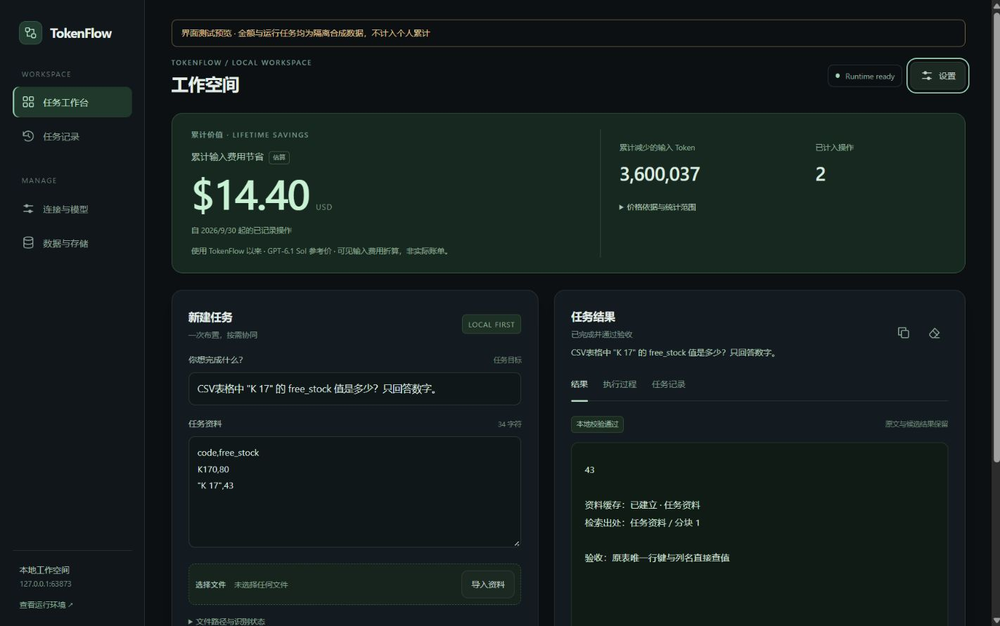

# 工作空间前端升级验证

日期：2026-10-21。范围依据：[已确认方案](../plans/premium-workspace-ui.md)。

## 实施结果

- 深墨色工作空间、墨绿费用概览、统一排版和内嵌图标。累计输入费用节省继续醒目展示，金额达到 1 美元后显示两位小数，微小金额保留必要精度；负值改为额外输入开销。
- 任务输入与结果并排；结果、执行过程和任务记录分别展示。历史结果标明所属任务，查看过程时轮询不会切走当前视图。
- 连接、模型、预算、存储、运行环境和高级工具移入原生设置抽屉。Escape 关闭并返回入口焦点；标签支持方向键、Home 和 End。
- 复制当前结果使用纯文本；空结果禁用，剪贴板不可用时给出提示。验收标签区分本地校验与模型复核，取消或失败状态不会被通过记录覆盖。
- 手机采用单列、全屏设置抽屉，文字输入至少 16px，主要操作至少 44px。保留真实耗时和等待动画，不展示虚构的模型完成百分比；遵循减少动态效果偏好。

所有修改限于页面、界面测试和文档。任务调度、模型适配、预算、解析/OCR、会话保护及费用账本的后端逻辑未变；无新增前端依赖或远程资源。

## 验证结果

| 检查 | 结果与证据 |
| --- | --- |
| 主程序自检 | PASS，包含编排、端云协同和本机 HTTP 检查；`tmp/premium-ui-selfcheck.log` |
| 评测自检 | PASS；`tmp/premium-ui-evalcheck.log` |
| 页面逻辑回归 | `node scripts/test_ui.js` PASS；覆盖历史/取消/回执、焦点返回、键盘标签、复制成功与失败、纯文本输出、验收状态、费用正负和不可用状态 |
| Python 语法 | `python -m py_compile ui_page.py` PASS |
| 浏览器实际操作 | 1440×900、1280×900、375×812 检查无横向溢出、无重复 ID；设置打开、Escape、焦点返回、标签方向键、部分结果及空结果均已验证；页面控制台错误为 0 |
| 新任务与恢复 | 浏览器提交 CSV 精确查值，结果 `43`、模型调用 `0`、`deterministic` 校验通过。复制保留结果与出处；刷新后可从任务记录找回。已完成结果不会自动重新填入新任务资料 |
| 费用异常显示 | 隔离账本制造负差值，显示“累计额外输入开销”；未知用量明确提示未计入金额。浏览器与实际 API 配合验证，不改用户账本 |
| EXE 冒烟 | PASS；新设置/视图/复制入口存在，任务、OCR 缓存、部分统计、查表、密钥保护、费用去重、预算、重启持久化、关闭服务均通过；`tmp/premium-ui-smoke.log` |

浏览器在隔离数据库中操作，截图中的费用与演示记录为合成数据，不代表用户真实累计。CSV 查值由真实程序执行；这些界面检查不扩大模型推理或费用节省的验证结论。原有模型质量评测结果仍以相应报告为准。

## 界面预览

桌面：任务输入与结果、累计价值、设置入口。

[手机视图](../assets/workspace-2026-10-21/mobile.jpg) · [设置抽屉](../assets/workspace-2026-10-21/settings.jpg)。

## 可执行文件

本地构建：`dist/workspace/TokenFlow.exe`；校验文件：`dist/workspace/SHA256SUMS.txt`。

- 大小：120,959,324 字节。
- SHA256：`b43bb0aea69ab26ae1f17c5696d372346cd128bef1c93d68081fee36057d470e`。
- 构建日志：`tmp/premium-ui-build.log`。

二进制与临时数据库不进入源码提交；GitHub Actions 会从提交构建独立产物。
