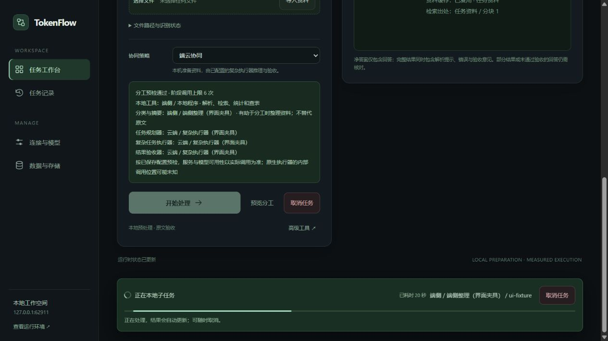
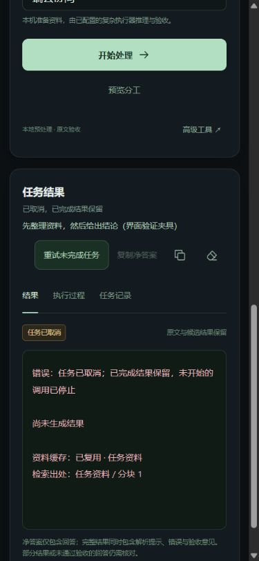

# 可信协同、任务恢复与运行一致性验证

日期：2026-10-22。实施依据：[已确认方案](../plans/trustworthy-collaboration-and-recovery.md)。本轮 P0/P1/P2 功能均已实施；功能验证与模型质量准入分别报告。复杂合成任务的本地 9B 模型质量门槛仍未通过。

**运行一致性与恢复。** 配置数据库现在分别持有服务锁和任务锁，由操作系统在进程退出后释放。跨进程读取、删除和清理共用同一所有权判断；不同数据库可以独立运行。桌面重复启动正常复用已有服务，包括关闭自动打开浏览器的情况；CLI 重复启动给出明确错误。任务固定 TokenFlow 保存的连接、模型、角色和 Harness 绑定，设置修改用于后续任务。原生程序自身的登录和外部配置仍由 Harness 管理。

重试使用新任务 ID、回执和预算，原任务与用量不覆盖；只复用已完成的只读步骤。无效验收响应可只重试验收，语义拒绝的最终候选重新生成。原资料必须仍可读取且内容哈希一致。解析失败、缓存缺失或更换、包含文件工具步骤时不能静默恢复。取消与调用/Token 预算仍然生效。终态与最终计量一起保存，避免轮询先看到完成而拿不到用量。

**本地验证与分配。** 明确的单值 Python 返回值查询可使用有界静态整数求值，支持赋值和无参函数依赖，不执行源码。不支持的语法、动态调用、循环、歧义、多项要求或资源超限回到原有流程。自然语言回答继续按原文验收，不能因 JSON 有效就推断事实正确。规划 Schema 已补齐步骤编号、依赖、输入范围和预期产出的必填约束；客户端继续检查唯一性、依赖关系、执行器与预算，不接受缺字段计划。

端云和仅本地策略按计划安排整理，避免预先摘要后重复整理；高级角色策略保留原有行为。单步判断使用选取后的资料，明确的短上下文请求可省去规划。阶段开始时就记录所请求的模型，进度不再等到调用结束才显示模型名称。

**工作空间。** 运行中的阶段、实际执行者、耗时和取消入口固定在页面下方；不显示虚构百分比。支持从历史记录重试，步骤区标明复用产出。“复制净答案”仅复制回答或已有部分回答，“复制完整结果”包含错误、解析提示和验收意见。查看历史时，后台轮询不切走当前记录。手机文字按钮与图标按钮分别设置宽度，恢复按钮不会被挤成竖排。

## 模型实测

全部为规则生成的合成样本，没有把合成数据称为真实业务数据。标准答案由生成器独立计算，不调用模型，也不依赖新增静态求值器。完整汇总见 [metrics.json](assets/trustworthy-20261022/metrics.json)。

本机 qwen3.5:9b 使用 Ollama 原生协议、关闭思考、温度 0、32768 上下文；原文执行和任务执行输出上限均为 2400，其他角色使用报告记录的运行时上限。评测使用隔离数据库，不写入日常配置、历史或累计节省。桌面后台验证与打包可能影响耗时，因此本报告不据此宣称延迟收益。

**原有两组各 60 题回归。** 本轮逐题名称和原文哈希与此前报告各匹配 60/60，保留原有质量门槛。

| 集合 | 此前完成且正确 | 本轮完成且正确 | 本轮流程调用 | 本轮门槛 |
|---|---:|---:|---:|---|
| 原 holdout | 55/60 | 60/60 | 76 | 未完成评测：1 次原文基线请求缺少用量 |
| 独立 V2 validation | 57/60 | 60/60 | 76 | 通过 |

两组各有 22 题零模型调用。V2 validation 的原文基线也是 60/60 正确，用量完整；流程输入 Token 减少 **12.68%**，输入加输出总 Token 减少 **8.24%**。原 holdout 的已知原文结果为 59/59 正确，但缺失请求不补零、不删除，不给这组完整收益结论。

**新增多步骤 V3 回归。** 生成开发集、保留集各 60 题，以及单独的 13 题拒答集合；开发与保留模板结构不同。保留集先暴露了规划字段缺失问题，修复后重新完整运行，因此这里称为修复后回归，不能再当作从未参与排查的盲测。

下表三种流程均使用本地 qwen3.5:9b，用来隔离流程影响，不能混称端云质量成绩。单次原文不做验收。

| 流程 | 最终答案正确 | 完成且正确 | 模型复核错误放行 | 阶段调用 | 总 Token |
|---|---:|---:|---:|---:|---:|
| 单次原文 | 24/60 | 24/60 | 不适用 | 60 | 5,615 |
| 原文＋生产验收 | 37/60 | 28/60 | 3 | 148 | 40,173 |
| 生产协作流程 | 43/60 | 38/60 | 4 | 135 | 56,212 |

协作流程仍有 5 个正确候选未获完成状态，1 次修正改善、1 次修正退化；总 Token 比单次原文增加 901.10%，比带验收基线增加 39.92%。准确率、分类覆盖和节省要求未全部达到，门槛为 **failed**。保留错误和候选轨迹，不通过放宽标签、移除失败或取消原文验收制造通过结果。

独立拒答集合的生产协作流程 **13/13 通过**，共 2 次模型调用，其余为确定性拒绝。它检查重复键、缺键、缺值、公式无缓存，以及缺少费用规则时明确回答资料不足。执行/传输失败不能当作正确拒答。该集合单列，不能抵扣正向样本错误，单独运行时不构成正向门槛通过。

**真实端云功能验证。** 请求模型为本机 qwen3.5:9b 和 Codex 原生 gpt-6-luna：

- 两题开发样例完成单次原文、原文加验收、生产协作三种对照；最终回答均正确。静态代码题在生产流程为零模型调用。
- 另一个明确要求端侧整理的依赖任务实际经历 `Codex 规划 → qwen 整理 → Codex 计算 → Codex 验收`，4 次阶段调用，结果 **73** 与预先标注一致。
- Codex 原生内部 usage 未完整提供，报告保留未知，不计算完整费用或 Token 净收益。少量功能样例不证明端云系统已通过完整复杂任务质量准入。

上述结果支持把本机 9B 模型用于受约束整理和已验证的窄任务；不能据此把它作为复杂多条件任务的可靠最终判定者。下一次质量准入需要独立样本及更完整的混合模型实测，费用比较还需要能够提供完整 usage 的现有 API 连接。

## 功能与交付验证

- 主程序自检、评测自检、UI 脚本、Python/JavaScript 语法与 Git 差异检查通过。新增检查覆盖跨进程保护、独立数据库、API/原生绑定快照、静态语义、预算、失败恢复、回执和禁止通过请求参数绕过验收。
- 三种对照工具按分支增量保存，轮换执行顺序；分角色保留调用、时间和用量，包含失败尝试，缺失用量不记零。Responses 混合连接的回归确认云端请求不会被误当作 Ollama 协议。
- 桌面 1280×720、手机 390×844 浏览器验证通过：滚动固定进度、实际模型名称、取消、历史不抢焦点、恢复、两种复制、设置说明和 Escape 返回焦点。手机无横向溢出，操作按钮高 44 像素。浏览器控制台未出现错误。
- 最终 EXE 冒烟通过：跨端口同库单实例、正常退出重复启动、受保护接口和密钥、CPU OCR、统计与查值、静态返回值 45、独立恢复与回执、预算/历史/节省持久化、重启和退出。失败测试时的 PyInstaller 父子进程清理也已修复。

最终源代码自检的一次重跑遇到本机 HTTP 连接中止（WinError 10053）；模型评测与打包结束后独立重跑完整通过，没有修改该断言来绕过错误。失败和通过的日志均保留。

截图使用明确标识的界面夹具，费用数值与模型调用为隔离测试数据，不是个人累计或真实模型性能成绩。





新版产物：`dist/trustworthy/TokenFlow.exe`，121,950,198 字节。SHA-256：

```text
d95db12c6fcf26bb20c7a1ad43ab23188c5b6b0033a615e2a3091be37178f051
```

校验文件：`dist/trustworthy/SHA256SUMS.txt`。旧版 `dist/workspace/TokenFlow.exe` 的 SHA-256 仍为 `b43bb0aea69ab26ae1f17c5696d372346cd128bef1c93d68081fee36057d470e`，没有覆盖。

完整原始报告与日志保留在本地 `tmp/trustworthy-eval-20261022/`、`tmp/trustworthy-selfcheck-confirmed.log`、`tmp/trustworthy-exe-smoke-release.log`；规划字段修复前的失败报告及 `tmp/trustworthy-selfcheck-verified.log` 也保留，没有覆盖。验证标签页、临时预览与本轮 EXE 子进程均已退出。现存的用户 Ollama 应用未关闭。未改动无关的 deliverables 或个人文档，本轮尚未提交 GitHub。
